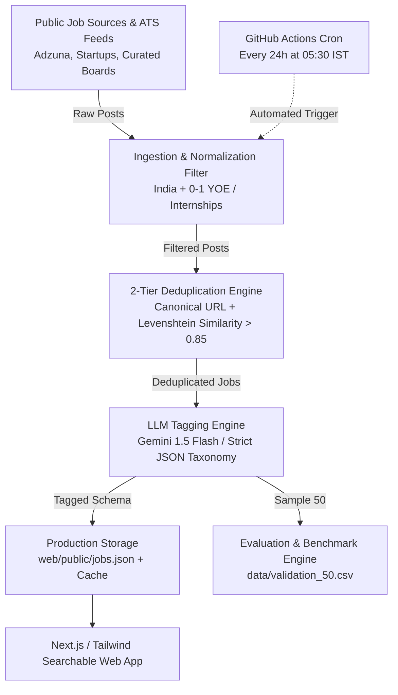

# Architecture & Design Specification

## System Overview
The **Beep Fresher & Internship Radar** is a real-time, automated AI pipeline and search tool designed for Indian college students seeking 0-1 YOE tech opportunities.

---

## 1. Data Ingestion & Ethical Collection
- **Sources**: Curated public career portals, ATS feeds (Greenhouse/Lever), and open developer job APIs.
- **Criteria**:
  - Location: India (Major tech hubs: Bengaluru, Pune, Delhi NCR, Hyderabad, Mumbai, Chennai, Kolkata, Remote).
  - Experience: 0-1 YOE, Fresher, College Interns, Batch 2024/2025/2026.
  - Ethical standards: Respects `robots.txt`, open public APIs, and no gated user authentication.

---

## 2. Smart 2-Tier Deduplication Algorithm
Job aggregators frequently re-index identical job listings with tracking query parameters or subtle title mutations.

### Tier 1: Canonical URL Stripping
Removes tracking parameters (`utm_source`, `utm_medium`, `ref`, `fbclid`, `gclid`) and trailing slashes to compute deterministic URL hashes.

### Tier 2: Company-Scoped Fuzzy Title Matching
1. Cleans company names (e.g. *"Swiggy Technologies Pvt Ltd"* → *"swiggy"*).
2. Cleans titles (expands abbreviations like *"SDE"* → *"software development engineer"*, removes years like *"2025"*).
3. Evaluates string similarity using `difflib.SequenceMatcher`:
   $$\text{Similarity Score} = \frac{2 \cdot M}{T}$$
   Where $M$ is matching characters and $T$ is total characters.
4. If similarity $\ge 0.85$ for the same company, the duplicate is purged, retaining the post with the richer description.

---

## 3. LLM Semantic Categorization (Gemini 1.5 Flash)
- **Model**: `gemini-1.5-flash`
- **Temperature**: `0.1` (deterministic classification)
- **Output Mode**: Strict JSON Schema enforcement

### Standard Taxonomies
#### 10 Standard Roles:
1. `Frontend Engineer`
2. `Backend Engineer`
3. `Full Stack Engineer`
4. `Data & AI / ML`
5. `Mobile App Developer`
6. `QA / Testing`
7. `DevOps / Cloud`
8. `UI/UX Design`
9. `Product Management`
10. `Non-Tech / Operations`

#### 8 Standard Tech Hubs:
- `Bengaluru`
- `Pune`
- `Delhi NCR` (includes Delhi, Gurgaon, Noida, Faridabad, Ghaziabad)
- `Hyderabad`
- `Mumbai` (includes Mumbai, Navi Mumbai, Thane)
- `Chennai`
- `Kolkata`
- `Remote` (Work from anywhere in India)

---

## 4. Automated 24-Hour Refresh Cycle
- Implemented as a GitHub Actions workflow: `.github/workflows/daily_refresh.yml`
- Scheduled on cron `0 0 * * *` (05:30 AM IST daily).
- Re-runs data collection, deduplication, LLM tagging, and updates the production dataset.

